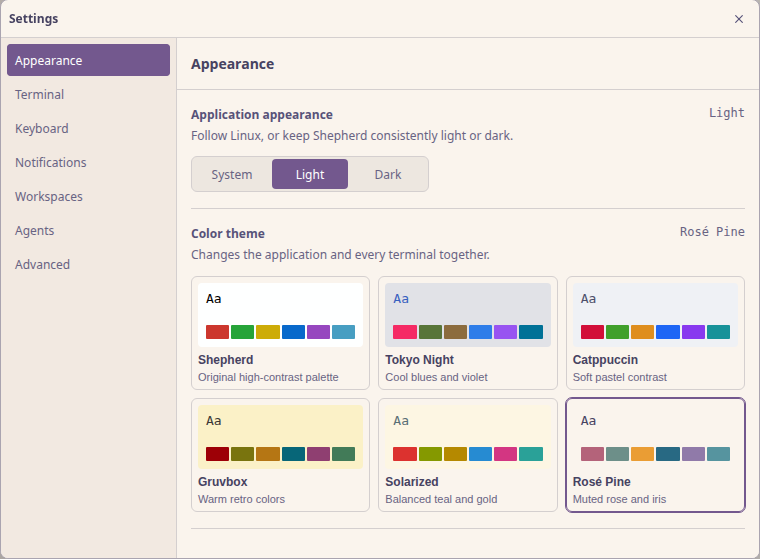

# Appearance and Terminal Themes

Shepherd coordinates application chrome and terminal content through a selected
color theme and a light or dark appearance. Changing either updates window
surfaces and every open terminal without restarting shells.

## Application appearance

Open Settings from the labeled button at the bottom of the sidebar, the gear
button on the collapsed sidebar, or `Ctrl+Shift+,`. Choose **Appearance**. Three
modes are available:

- **System** follows the desktop's resolved light or dark appearance.
- **Light** keeps Shepherd chrome light.
- **Dark** keeps Shepherd chrome dark.

The main process applies the requested mode through Electron `nativeTheme` and
reports resolved changes back to the renderer. The document stores the resolved
appearance as a data attribute, allowing every surface to consume one semantic
token contract.

## Color themes

Choose a color theme in Settings → Appearance:

- **Shepherd** preserves the original palette: pitch-black `#000000` in dark
  appearance and `#feffff` in light.
- **Tokyo Night** uses cool blue and violet colors, with a lighter daytime variant.
- **Catppuccin** uses soft pastel colors, with a light variant.
- **Gruvbox** uses warm retro colors, with a cream-colored light variant.
- **Solarized** pairs teal and gold accents with dark and light backgrounds.
- **Rosé Pine** pairs muted rose and iris accents with a Dawn-like light variant.

Each option previews its terminal background, text, and ANSI accents. A preset
changes both CSS chrome tokens and the xterm palette, including foreground,
background, cursor, selection, and ANSI colors. The appearance mode still
controls which dark or light variant is used. Existing terminals update in place;
new terminals start with the saved theme.



## Semantic token contract

Application CSS uses named roles rather than component-specific raw colors. The
roles cover:

- canvas, sidebar, ordinary and raised surfaces;
- primary, secondary, and muted text;
- ordinary and strong borders;
- accent, focus, selection, attention, danger, success, information, and working
  state;
- backdrop, popover shadow, spacing, radii, and transition timing.

Raw color values are kept at the root dark, light, and preset token boundaries. Controls,
workspace rows, pane chrome, dialogs, and the inspector consume those roles. The
default geometry is restrained, surfaces remain neutral, and a single blue
accent is reserved for selection, focus, and small identity details.

## Typography and motion

Controls use the system UI stack. Monospace is reserved for terminal content,
paths, ports, commands, and similarly technical values. Essential interface text
is not rendered at decorative sizes.

Transitions are brief and purposeful. When the operating system requests reduced
motion, Shepherd disables non-essential animation and smooth scrolling. Agent
attention does not pulse continuously; a bounded pane ring appears only when a
new actionable event arrives.

## Stored preferences

Renderer preferences are versioned. The current record contains:

```ts
interface RendererPreferences {
  version: 3
  terminalFontSize: number
  appearanceMode: 'system' | 'light' | 'dark'
  themePresetId: 'system' | 'tokyo-night' | 'catppuccin' | 'gruvbox' | 'solarized' | 'rose-pine'
}
```

Version-one Graphite and version-two System palette settings migrate to the
Shepherd theme while preserving font size and appearance. Older standalone font
keys also migrate. Invalid JSON, unsupported modes, non-finite font sizes, and
unknown theme identifiers fall back to validated defaults rather than reaching
xterm or native theme APIs.
