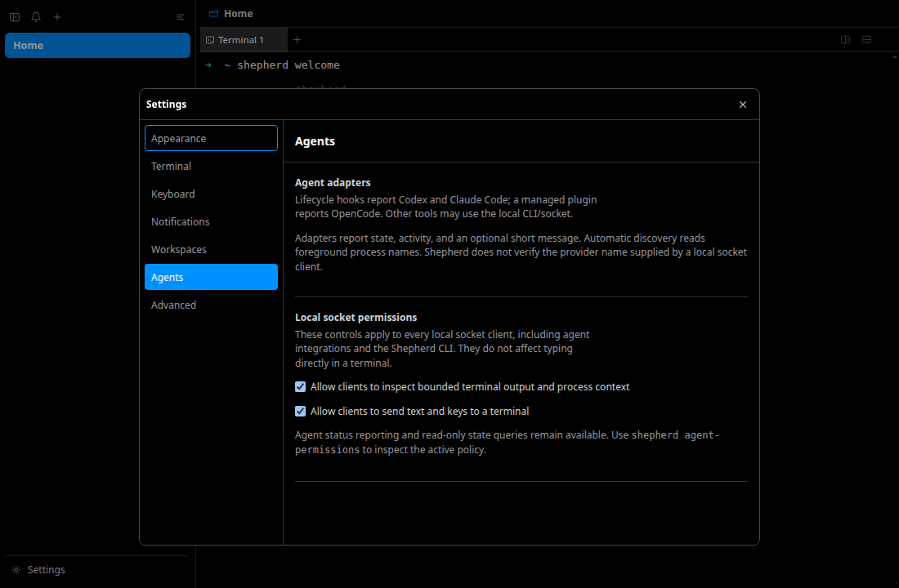
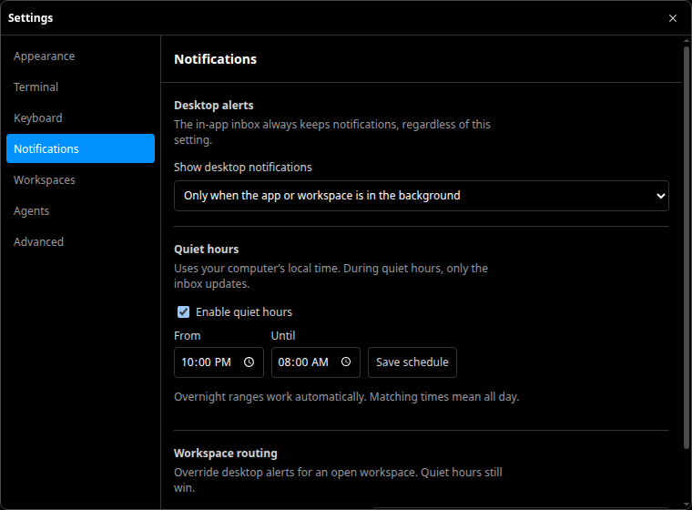
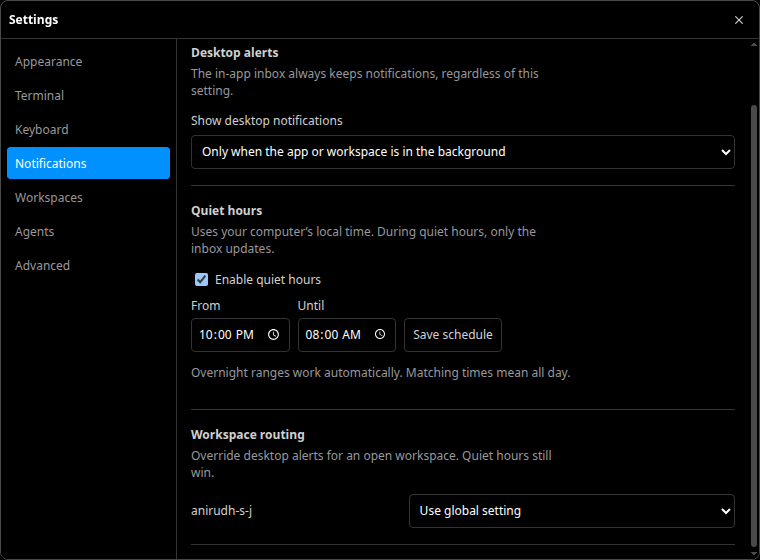
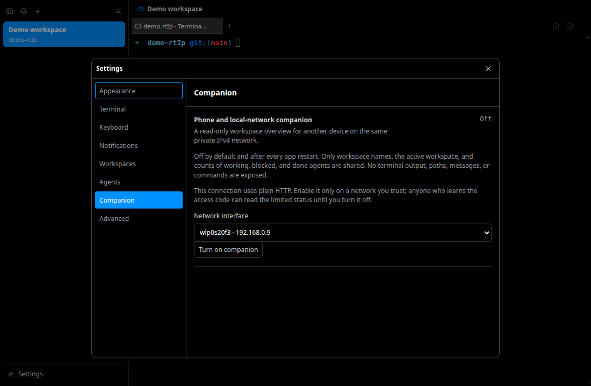
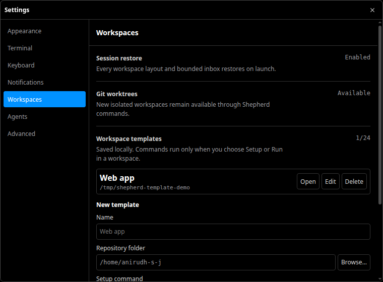
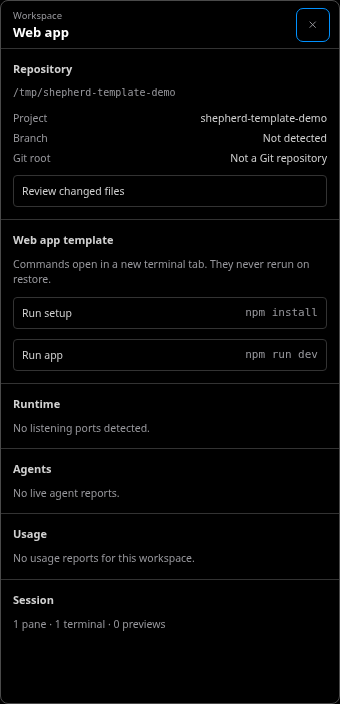
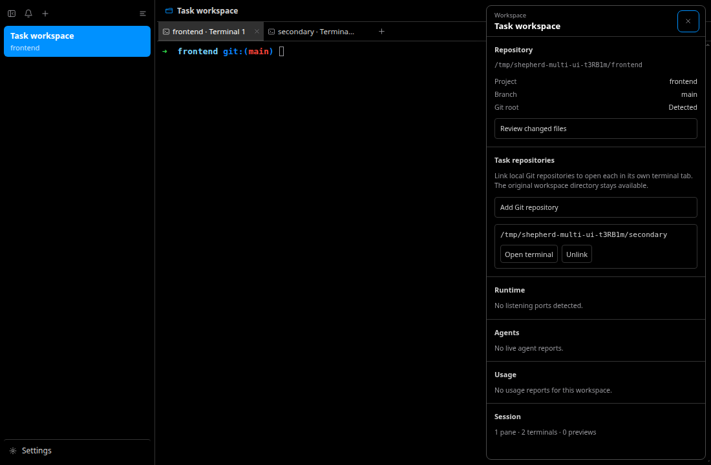

# Terminal Workbench

Shepherd is a graphical terminal multiplexer with agent awareness. Its interface
keeps the shell dominant and reveals project or agent context only when that
context helps a person decide what to do next.

## Interface hierarchy

The visible hierarchy matches the runtime model:

```text
window
└── workspace
    └── pane
        └── surface
            ├── terminal panel
            └── localhost preview panel
```

A workspace owns a resizable pane tree. Each pane has a tab list of surfaces, and
each surface contains either a real terminal or a constrained preview. One compact
workspace titlebar spans the pane layer, keeping project identity stable while
each pane's tab row remains dedicated to its surfaces.

## Workspace rail

The left rail is for navigation, not exhaustive metadata. Every workspace has a
two-line row:

- the user-defined name, or the live project name when no custom name exists;
- a short semantic rollup such as `2 working` or `1 needs you · 1 finished`.

The rollup always uses text. Color supports the state but is never the only way
to distinguish it. Working and idle agents remain available through workspace
inspection without occupying permanent rows.

Workspace rows support pointer selection, context menus, renaming, and keyboard
navigation with Arrow keys, Home, End, Enter, and Space. Pressing F2 starts an
inline rename.

## Attention

The Attention section contains only actionable information:

- an agent blocked on approval or user input;
- an agent that completed while its workspace was not being watched.

Working, externally waiting, idle, stale, and already acknowledged agents do not
fill this section. Selecting an Attention item activates the owning workspace,
pane, and terminal tab, then restores input focus to xterm.

The notification inbox remains separate. It receives bounded socket, OSC, and
agent-lifecycle records, supports unread navigation, and distinguishes reading an
item from resolving the underlying event.

Desktop alerts are configured in Settings → Notifications. The global route can
show every alert, show only background alerts, or turn desktop alerts off. Quiet
hours suppress toasts using local time, including overnight ranges; each open
workspace can override the global route except during quiet hours. These rules
never remove an inbox record or suppress its unread state. A clicked desktop
alert reopens a hidden workbench and selects the related workspace.

Settings → Agents describes lifecycle adapters and automatic process discovery.
It also controls whether local socket clients can inspect bounded terminal
output/process context or send text and keys. These app-wide switches take
effect immediately; they do not disable direct terminal typing or agent state
reports. The CLI's `agent-permissions` query shows the current policy.







## Local-network companion

Settings → Companion offers an opt-in, read-only status page for another
browser on a private IPv4 network. Select the interface, start the listener,
and enter its fresh access code on the other device. The page updates only on
manual refresh. Stopping the listener clears the code; it never auto-starts on
launch.

The page receives workspace names, active selection, and counts of working,
blocked, and done agents. It receives no terminal output, paths, messages,
usage, or command endpoint. Its HTTP transport is unencrypted, so use it only
on a trusted LAN.



## Pane and tab chrome

The workspace uses a 34-pixel identity titlebar above each pane's 30-pixel tab
row. Pane boundaries stay flat instead of adding a permanent active-pane glow.
The active tab uses a restrained raised surface and neutral edge; every tab keeps
an accessible close name. Split, add-tab, and close-pane actions remain quietly
visible with consistent control sizes and focus rings.

Left and Right move between focused tabs, Home and End jump to the first or last
tab, and Delete closes the focused surface when another surface remains. The
command palette and contextual menus hold operations that do not deserve
permanent space.

## Workspace inspector

The workspace titlebar button, workspace context menu, and `Inspect current
workspace` command all open the same non-modal inspector. It reports only current
runtime data:

- repository path, project, Git branch, and pull request;
- listening ports owned by descendants of the active terminal shell;
- current agent reports and semantic states;
- reported token, cache, cost, and provenance totals;
- pane, terminal, and preview counts.

A pull-request row opens its validated HTTPS URL. A port row opens the existing
loopback-only preview flow. An agent row focuses that agent's real terminal. The
panel closes with its close button or Escape and restores focus to the element
that opened it unless an action intentionally moves focus elsewhere.

Workspace metadata follows the active terminal. Git discovery is re-probed when
the active terminal surface changes, preventing one surface's repository result
from being reused for another.

## Workspace templates

Settings → Workspaces holds local templates. Each records a display name, a
directory chosen with the native picker, and optional one-line Setup and Run
commands. At least one command is required. Opening a template creates a
workspace in that directory; it does not execute either command.

The workspace inspector exposes the configured commands with their exact text.
Choosing one creates a dedicated terminal tab in the template directory and
sends the command only after its PTY is ready. Commands are transient and are
not replayed during session restoration. Editing or deleting a template does
not close existing workspaces.





## Task repositories

The workspace inspector can link up to eight additional local Git roots to one
task workspace. The native folder picker and main-process Git check establish
the root; duplicate and non-Git selections are rejected. Open terminal creates
a tab whose launch directory is that root, without replacing the original tab.
Unlink removes the shortcut but leaves any running tab alone.

The session snapshot retains linked roots, the original workspace directory,
and each terminal tab's latest known cwd. Restoring starts new shells in those
directories, not the old processes. Repository metadata and changed-file review
follow the active terminal, so work in different repositories stays contextual.



## Localhost preview

Preview surfaces accept loopback URLs only. The main process applies a dedicated
ephemeral partition, a restrictive Content Security Policy, navigation checks,
and request filtering. Remote hosts, popups, downloads, permission requests,
credentials, executable schemes, and persisted unsafe preview URLs are rejected.

Each preview is a normal surface in the pane tree. It can be selected, moved
through tab navigation, closed, and restored when its URL still passes the
loopback policy. Webview operations that require guest readiness run after
`dom-ready`.

## Empty and failure states

Unavailable data is stated plainly: no live agent reports, no listening ports,
no usage reports, no Git repository, or no pull request. A preview reports load
and renderer failures inside its surface. A workspace always retains at least
one terminal, and closing operations refuse to destroy the final required shell.

## First launch

A new local profile starts with one workspace, one terminal, and the ordinary
interactive shell prompt. After that shell is ready, Shepherd runs `shepherd
welcome` inside the terminal to show the essential workspace, tab, pane, command,
search, and attention shortcuts. The guide is shown once per profile, does not run
for a restored session, and can be replayed at any time with `shepherd welcome`.
